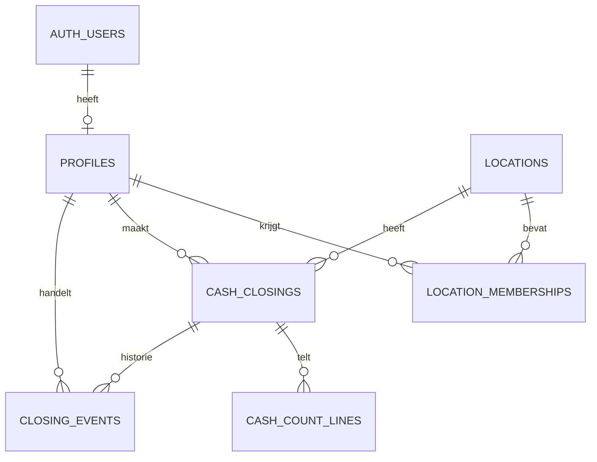

# Databasestructuur

Migrations: `supabase/migrations/20261101185024_os_werkplek_foundation.sql` en `20261101185305_restrict_rls_helper.sql`. De versies komen overeen met de Supabase-testdatabase.

| Tabel | Functie |
| --- | --- |
| `auth.users`, `auth.mfa_factors` | Supabase beheert accounts/authenticators; geen eigen kopieën van wachtwoorden/secrets |
| `profiles` | Auth-ID, naam, medewerker/manager, actief |
| `locations` | Heiloo en Heerhugowaard met vaste ID's |
| `location_memberships` | Vestigingstoegang per medewerker |
| `cash_closings` | Vestiging, werkdatum, medewerker-ID/naamsnapshot, status, centbedragen, toelichting/notities, versie, idempotentiesleutel en tijdstippen |
| `cash_count_lines` | Afslag, coupurecenten, geheel aantal en berekend subtotaal |
| `closing_events` | Wie/wat/wanneer, reden, waarden vóór/na |

`work_date` is een datum zonder tijdzone; indien-/controlemomenten zijn `timestamptz`. De werkdatum wordt in Europe/Amsterdam bepaald, los van UTC-opslagtijden.

## Beveiliging

Alle bedrijfstabellen hebben RLS. Anoniem heeft geen tabelrechten; authenticated in fase 1 alleen SELECT. Iedere leespolicy controleert actief profiel, AAL2 en bevestigde TOTP-factor. Een verouderde AAL2-token na verwijderen van alle factoren geeft geen data vrij.

Helpers in schema `private` gebruiken alleen de huidige aanvrager, een lege search_path, expliciete schema's en beperkte uitvoerrechten. Dit schema is niet via de Data API beschikbaar. Rollen komen niet uit bewerkbare user_metadata. Medewerkers kunnen zichzelf ook via de API niet promoveren.

Managers lezen beide vestigingen. Medewerkers lezen toegewezen vestigingen en voorlopig alleen eigen afsluitingen/tellingen/historie. Actief-vlag en toewijzingen werken direct.

## Voorbereid, nog niet actief

- Versie voor optimistische gelijktijdigheidscontrole.
- Unieke indieningssleutel; de idempotente transactie/RPC volgt in fase 2.
- Unieke index op vestiging/werkdatum vanaf eerste indiening, ook na heropenen.
- Indiening vereist bedragen en zo nodig verschiltoelichting; controle vereist controleur/tijdstip.
- Geld als integer/bigint-centen. Standaard eurocoupures; 0–10.000 aantallen als voorlopige technische grens.
- Totaalcontrole over telregels, naamsnapshot afdwingen, versieverhoging, statustransities en audit gaan binnen schrijftransacties gebeuren in fase 2/3.

Er is nu geen schrijfendpoint. De constraints voeren de workflow zelf nog niet uit. Audit heeft geen app-schrijf-/verwijderrechten; toekomstige transacties maken die gebeurtenissen aan.

## Aanvulling: gebruikersbeheer

Migration `20261101193151_configurable_roles.sql` voegt `app_roles` en `access_events` toe, met RLS en uitsluitend leesrechten op tabellen. Profielen hebben `access_role_id` en `management_version`; het oude `role` verleent geen rechten meer. Bestaande medewerkers/managers zijn naar de bijbehorende startrol gemigreerd. Vince is daarna op expliciet verzoek als eerste beheerder ingesteld met een auditregel.

De drie beperkte admin-RPC's zijn de enige app-schrijfroute voor rechten en profielen. Ze vereisen actuele beheerderstatus én MFA, valideren invoer, controleren versies, beschermen de laatste actieve beheerder en schrijven audit binnen dezelfde transactie. Directe updates op tabellen blijven geweigerd. Zie GEBRUIKERSBEHEER.md voor het model en de testwijze. Kassa-schrijfendpoints zijn nog steeds niet beschikbaar.
